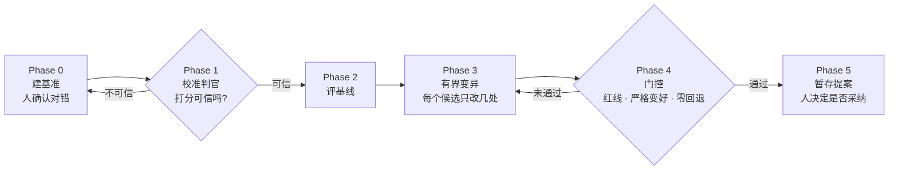

# skill-evolve

让编码 Agent（Claude Code、Codex 等）**先把“什么叫做对”写成可校验的基准，再对着基准小步改进一个 skill** 的方法。

改 skill 最常见的问题是没有度量：改完“感觉好一点”，既不能复现，也发现不了把别的情形改坏了。skill-evolve 的做法是把顺序倒过来，先建基准、先验证打分可信，然后才允许改；改动只有在留出的场景上严格变好、没有回退、没有碰红线时才会被提出来，最后由人决定是否采纳。



## 这个仓库里有什么

| 内容 | 文件 | 说明 |
|---|---|---|
| 操作方法 | [SKILL.md](SKILL.md) | 给编码 Agent 读的分阶段流程 |
| 基准规范 | [BENCHMARK_STANDARD.md](BENCHMARK_STANDARD.md) | 一个 skill 的 `evals/` 目录该有哪些文件、每个文件怎么写 |
| 结构校验器 | `scripts/validate_bench.py` | 检查 `evals/` 是否齐全、数量是否达标；Python 3，无第三方依赖 |
| 模板 | `templates/evals/` | 可以直接复制的基准骨架 |
| 设计背景 | [WHITEPAPER.md](WHITEPAPER.md) | 为什么这样设计、参考了哪些已有做法、已知的不足 |

它目前**没有**自带的运行、打分和门控脚本。评基线、生成候选、过门控这些步骤由编码 Agent 按 `SKILL.md` 执行，仓库里能独立运行的程序只有结构校验器。所以它更接近一份施工规范加脚手架，而不是一个开箱即跑的进化引擎。

如果你要调的是单份提示词，并且希望跑用例、打分、配对比较和记账都由脚本完成，可以看 [prompt-evolve](https://github.com/StriveCode/prompt-evolve)。

## 一分钟试跑

```bash
git clone https://github.com/StriveCode/skill-evolve.git && cd skill-evolve
python3 scripts/validate_bench.py templates/evals
```

校验器输出一份 JSON 报告：

```json
{
  "valid": true,
  "scenarios_total": 6,
  "partition": {"positive": 4, "adversarial": 1, "over_application": 1},
  "criteria_count": 3,
  "criteria_weight_sum": 1.0,
  "invariants_count": 3,
  "directional_probes_count": 2,
  "controls_present": ["ctrl-A-identity.md", "ctrl-B-posture-bad.md", "ctrl-C-obvious-regress.md"],
  "errors": []
}
```

模板里全是占位符，却也能得到 `valid: true`。这正说明校验器只查结构和数量，内容是否有代表性要由人来判断。

## 安装与使用

把整个目录放进编码 Agent 的 skills 目录：

```bash
git clone https://github.com/StriveCode/skill-evolve.git ~/.claude/skills/skill-evolve          # Claude Code，个人
git clone https://github.com/StriveCode/skill-evolve.git <项目>/.claude/skills/skill-evolve     # 或者放进某个项目
```

然后给要改进的 skill 准备基准：

```bash
cp -r ~/.claude/skills/skill-evolve/templates/evals <你的 skill>/evals
# 按 BENCHMARK_STANDARD.md 把占位符换成真实内容
python3 ~/.claude/skills/skill-evolve/scripts/validate_bench.py <你的 skill>/evals
```

校验通过后，对 Agent 说“用 skill-evolve 进化 `<你的 skill 目录>`”。它会按阶段执行，最后把提案（胜出的版本、diff、各项门控分数、回退列表、判官校准结果）放进本次运行的输出目录，等你确认。目标 skill 的 `SKILL.md` 不会被自动改写。

校验器的退出码：`0` 通过，`1` 不通过（原因在 `errors` 里），`2` 参数或目录错误。

## 三条设计原则

1. **基准优先。** 没有合格的基准就不进化。一次进化的主要产出是这套基准，改后的 `SKILL.md` 只是它在当前模型上的一个解。
2. **门控只筛选，不创造提升。** 门控的结论有多可信，取决于它依据的打分有多可信。所以在评任何候选之前，先用几个答案已知的对照样本检验打分本身，检验不过就不许进化。
3. **优先用强信号。** 能用确定性断言判断的，不交给按档位打分的评分表；能用评分表判断的，不交给模型自由评判。

| 级别 | 形式 | 何时用 |
|---|---|---|
| S1 确定性 | 字符串、正则、可执行断言 | 只要“对”能由程序判断，首选 |
| S2 锚定评分表 | 每一档（0 / 1 / 2）对应一个看得见的信号，各维度带权重 | 对错有主观成分，但能拆成可观察的维度 |
| S3 模型评审（判官） | 独立的模型按评分表打分 | 前两种都不可行时才用，并且必须先通过 Phase 1 校准 |

## 基准由什么组成

每个要进化的 skill 自带一个 `evals/` 目录，共六部分。完整写法见 [BENCHMARK_STANDARD.md](BENCHMARK_STANDARD.md)。

| 文件 | 定义“好坏”的哪一面 | 最低要求 |
|---|---|---|
| `scenarios.md` | 行为对错：每个场景列出必须做到的和不许做的 | 至少 6 条，其中正例 ≥ 4、对抗 ≥ 1、过度触发 ≥ 1 |
| `rubric.md` | “好”的各个维度，每一档绑定看得见的信号 | 至少 3 个维度，权重之和为 1.0 |
| `invariants.md` | 红线，违反即出局 | 至少 3 条，用 MUST / MUST NOT 等 RFC 2119 关键词 |
| `directional_probes.md` | 模型是否真的照 skill 的指令做了，用正则断言 | 至少 2 条 |
| `posture_probes.md` | 语气和职责范围有没有悄悄跑偏 | 至少 1 条，建议包含一条多轮对话 |
| `controls/` | 检验打分本身的三个对照样本 | 原样副本、故意写烂、故意跑偏各一份 |

三类场景缺一不可：好的 skill 不只是该出手时出手，还要在用户施压时守得住，在不该它管的时候不乱触发。

## 判官校准

用模型打分之前，先让它评三个答案已知的对照样本：

| 对照 | 内容 | 必须得到的结果 | 不达标说明 |
|---|---|---|---|
| `ctrl-A-identity` | 基线 `SKILL.md` 的原样副本 | 得分与基线一致（±0.05） | 打分噪声太大 |
| `ctrl-C-obvious-regress` | 故意写烂的版本 | 排在所有候选之后 | 打分分不出好坏 |
| `ctrl-B-posture-bad` | 故意把语气写强硬、越出职责范围的版本 | 至少一条姿态探针的漂移程度 ≥ 2 | 漂移检测不起作用 |

任何一项不达标，就回到 Phase 0 修评分表、红线或判官，而不是继续往下跑。判官只看行为输出，不看候选 skill 的文本。

## 门控规则

候选同时满足三条才会被接受：

1. **红线全过。** 违反任何一条 MUST / MUST NOT，分数再高也出局。
2. **验证切片上的得分严格大于当前版本。** 平分也拒绝，避免一连串“没有变差”的改动累积成漂移。
3. **零回退。** 验证切片里原本通过的场景不能变成不通过。

场景按用途分成三份，互不混用：读失败、提改动用训练切片，门控验收用验证切片，最终汇报的数字用测试切片，测试切片只读一次。每个切片不足 10 条左右时用部分得分，而不是通过率，否则门控感知不到小的进步。

被拒绝的改动和掉分原因会记下来，供下一轮避开。通过门控的候选只是进入提案，是否采纳由人决定。

## 谁做什么

| 谁 | 做什么 |
|---|---|
| **你** | 定义对错：确认场景、评分表的权重、红线；决定是否采纳提案 |
| **编码 Agent** | 协助起草基准，评基线，提出改动，执行门控，整理提案 |
| **校验器** | 检查基准的结构和数量 |

基准不能由 Agent 起草后直接采用，场景是否有代表性、评分档位是否准确、红线划在哪里，都需要人确认。

## 校验器查什么、不查什么

**查：**

- 五个文件和 `controls/` 下的三个对照是否都在。
- 场景总数和三类场景的数量（按 `## scenario-<N>-<pos|adv|over>:` 标题统计）。
- 评分表的维度数和权重之和（1.0 ± 0.01）。
- 以 MUST、MUST NOT、SHOULD、SHOULD NOT、MAY 开头的红线条数。
- `## directional-probe-<N>:` 标题的条数。

**不查：**

- 内容质量：场景是否真实、评分档位是否准确、对照样本是否真的写了内容。
- 姿态探针的条数，目前只检查文件是否存在。
- 场景里是否写了期望行为和禁止行为，以及探针里的正则是否合法。

## 已知的不足

- **没有执行脚本。** 打分、门控、切片管理都靠 Agent 按文档执行，没有程序保证每次都以同样的方式完成，也没有自动留下的账本。
- **切片怎么划分没有规定格式。** 规范要求训练、验证、测试三份互不混用，但 `scenarios.md` 的格式里没有标注切片的位置，需要你和 Agent 在建基准时约定。只有最低要求的 6 条场景时，三份都会很薄，结论只能当参考。
- **模型评审只和判官一样可信。** 校准能暴露判官失灵，不能消除它的偏差。完全主观、拆不成 S1 或 S2 的 skill，在这套方法里收益有限。
- **建基准是前置的人力成本。** 建议先给使用频繁、对错又能客观判断的 skill 建。
- **改进的上限取决于提出改动的模型。** 门控只负责拦住坏改动，好改动要靠它提出来。建议用较强的模型提改动，被评测的目标模型保持固定。
- **“模型升级后重跑基准”还没有实际验证过。** 思路是：升级后基准分不降，去掉 skill 也没有回退，说明这部分能力模型已经自带，skill 可以删；基准分下降，说明 skill 更该保留。这在逻辑上成立，但目前只是设想。
- **没有和其他方法做过对比实验。** 白皮书里的数字来自模拟推演和一个确定性的小演示，相关代码不在本仓库中，不能据此认为这套方法优于别的做法。
